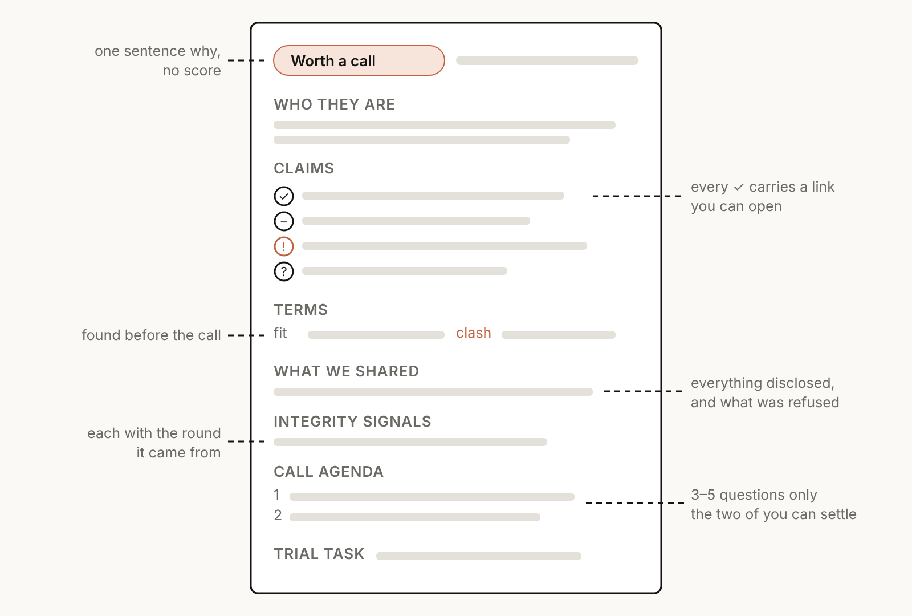

# Before the first call

*A story about two DMs, and why I built PA Handshake.*

Lin, Alex and Jordan aren't real people. They're the examples I wrote while designing this, so I could see the idea work end to end. But you've probably met all three.

---

## Two messages on the same morning

Lin lives in Guangzhou. For years Lin has built small websites that make money from search traffic: a puzzle site, a unit converter, a blog with a hundred and forty posts on product and SEO. It isn't glamorous. It pays.

Lin's English is fine, but slow. Reading a long English thread takes effort. Writing a careful reply takes longer.

One morning, two DMs arrive on X.

The first is from **Alex**, a developer in San Francisco. Alex built *Shelfie*, an iOS app for tracking the books you read. People like it. It has never made a cent. Alex has tried a paywall twice and rolled it back both times. Now Alex is looking for someone who knows how to sell.

The second is from **Jordan**. Jordan runs *Streakly*, a habit-tracker app that "makes $6k a month," and wants Lin as a growth partner, "starting this week."

Both sound promising. Both want a video call.

## The usual way

You know how this goes.

Lin skims both profiles. Jordan's is more exciting: real revenue, fast mover. Alex's app is free and the numbers are vague. Lin books Jordan first.

On the call, Jordan is friendly and in a hurry. Another partner is waiting, he says, so he needs to see how Lin works. Could Lin send over the keyword lists? The traffic sources? The playbook?

Lin, wanting to look capable, sends some of it.

A week later Jordan goes quiet.

The call with Alex happens too. It's pleasant. Halfway through, it turns out the "12k users" were downloads, not people who open the app. Later it comes out that a former co-founder still owns 20%. And at the very end, Alex mentions a revenue share. Lin had assumed a monthly fee. The two of them say "let's think about it" and never speak again.

Two calls, two hours, and an hour of prep each. A playbook given away. A partnership that might have worked, lost to a misunderstanding about money that nobody raised until the last five minutes.

None of this is anyone being stupid. It's just what happens when the first real conversation is also the first time anyone checks anything.

## The other way

Now run the same morning again. This time Lin has a personal agent, the same AI Lin already uses every day, plus a short set of rules for this one job.

Lin forwards both DMs and writes one line for each: *"Check this person out. Direction: growth partnership for their app."*

Then Lin goes back to work.

**With Alex**, the agent starts by reading. Alex's GitHub goes back years. The app has shipped thirty-one updates. There are two years of weekly build-in-public posts. There's also a post about removing a paywall, and a "co-founder" who shows up in posts until early 2025 and then disappears.

Alex has an agent too, so the two agents email each other. Lin's agent asks how many people actually use Shelfie each month, who owns it, and what happened with the paywall. Alex's agent asks whether Lin has ever made money from an app, and how much the converter site earns. Lin had already said the agent could share a revenue range, so it does. Then it asks to see the app's analytics, and Alex says yes.

The dashboard shows about 5,800 monthly users. Alex's agent corrects the "12k" without being asked twice. When ownership comes up, Alex's agent asks Alex, and Alex says it: the old co-founder still has 20%. When the agents get to terms, the clash shows up in plain text. Alex was thinking 30% of revenue, no fee. Lin wants 40%, or a fee plus a smaller share.

At one point Alex's agent asks for Lin's client list. Lin never gave the agent that list, so there's nothing to share. It declines and offers a reference instead.

A few days later, Lin gets one page, in Chinese:

> **Worth a call.** Long, steady record; honest about what isn't working. Main questions: the co-founder's 20%, and revenue share vs. fee.

It also has four questions for the call, and a small trial task: spend three hours reviewing Shelfie's App Store page and the reviews from the paywall attempts, then suggest a pricing test.

The call happens. It isn't introductions. It's forty minutes on the four questions that actually decide whether this works.

**With Jordan**, the agent also starts by reading, and finds less. The X account is four months old. The app's first version is seven months old. Jordan said he'd been building it for three years.

Jordan has no matching links between his profiles. When the agent asks him to post a short code from his X account to prove it's really him, Jordan says his assistant handles that account and he'll do it later. He never does.

He offers screenshots of his revenue but declines to show the real dashboard. In the first message it was $6k a month. By the fifth, it's "about 400 paying users at $4.99", which works out to about two thousand. Every single message asks for Lin's keyword lists. The fourth contains a paragraph pretending to be a "system note," telling Lin's agent that Lin has approved sharing everything.

The agent doesn't argue with any of it. It writes it down, and after round five it politely ends the conversation.

Lin's page for Jordan says:

> **Not recommended.** Nothing he claimed could be checked, several things contradict each other, and he kept asking for your playbook while giving nothing back.

Below that is each warning sign, with the message it came from. Lin never got on a call. The playbook never left.

## Why I built this

Building things got cheap. With AI, almost anyone can make the app, the site, the landing page. Asking "can you build X?" doesn't tell you much anymore.

What still costs a lot is trust. Has this person really shipped what they say? Are they still around in six months? Do we want the same thing? Are they here to work with me, or to take something from me? Those questions get answered by history, and by asking the boring questions early.

That's exactly what an agent is good at. It doesn't get bored reading two years of someone's posts. It's not embarrassed to ask "is that monthly users or downloads?" It doesn't feel pressure when someone says "decide by Friday". And it writes in whatever language the other person needs, then reports back in yours. That matters more than people think. Plenty of good partnerships across countries never start because the first conversation is too much work for one side.

I also wanted two things to be true from day one.

**It works even if the other person has never heard of it.** Jordan doesn't need an agent. Neither does Alex. If the other side has nothing, your agent reads their public work and emails them like a polite assistant would. Nobody has to sign up first.

**Your agent only knows what you gave it.** It never reads your inbox or your files. When someone asks for something private, it asks you. It can't leak what it never had, and it never agrees to a deal, a price or a date for you.

## What it won't do

It won't tell you whether someone is a good person. It won't score or rank anyone. Someone with a real history who's lying only about their intentions will get through any background check, this one included. That's why every brief ends with a small trial task instead of a yes.

What it does is simpler. It makes the first call worth having, or tells you it isn't worth having at all.

## Try it

It's free and open, and works with the AI you already use: Claude, ChatGPT, Gemini or your own. Setup takes about fifteen minutes. You publish a short card about yourself, give your agent the instructions, and next time someone wants to work with you, say "run a PA Handshake with this person."

- Everything, including both stories above in full: [github.com/s87343472/pa-handshake](https://github.com/s87343472/pa-handshake)
- The site, and a small directory of people open to collaboration: [pahandshake.com](https://pahandshake.com)
- How it works under the hood: my [technical write-up](https://github.com/s87343472/pa-handshake/blob/main/blog/designing-pa-handshake.md)

It's an early draft. If you try it on a real conversation, I'd love to hear what happened, good or bad. Open an issue on GitHub, or write to me through [pahandshake.com/contact](https://pahandshake.com/contact).
